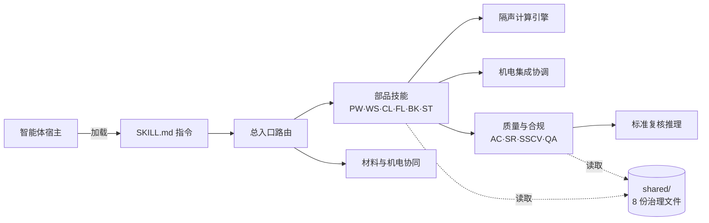

# 代码架构

本仓是**技能分发面**：没有服务端、没有构建步骤、没有第三方依赖。运行的“代码”分两类：被宿主加载的 `SKILL.md` 指令，以及随包的少量 Python 引擎与工具。本文说明它们的边界、数据流与扩展点。

## 1. 两层形态

| 层 | 位置 | 作用 |
|---|---|---|
| 分发面（本仓） | GitHub `prefab-interior-agent` | 技能本体、治理文件、安装与自检工具；只读使用 |
| 开发仓（私有） | 不对外公开 | 技能源、台账、批次脚本与全量门禁；改动先落此，再派生 |

`技能仓备份/` 是技能本体的根目录（仓内沿用开发仓的目录名）；`tools/install.py` 把它的内容复制到宿主技能目录。两层的边界与文件构成见 [README 的「公开面边界」](README.md#公开面边界随包--不随包)。

## 2. 运行时结构

- **入口层**：`prefab-interior-systems-orchestrator` 识别意图并分派。
- **部品层**：隔墙、墙面、吊顶、楼地面、厨卫、收纳六个专项技能。
- **计算与协同**：`acoustic-calculation-engine`（隔声）、`prefab-mep-integration-system`（机电）。
- **质量与合规**：验收清单、标准复核、条文核验、技能 QA。
- **治理**：`prefab-governance-sync` 与 `shared/` 下的 8 份治理文件（标准索引、契约、红线、术语、数据分级等）。

## 3. 代码模块

| 模块 | 规模 | 职责 | 公开测试 |
|---|---|---|---|
| `技能仓备份/acoustic-calculation-engine/ace_kernel.py` | 1,482 行 | 质量—频率诊断、MSM 模型、吻合效应；系统定量预测现阶段暂停 | 回归套件在开发仓，未随包 |
| `技能仓备份/prefab-standards-reviewer/sre_reasoner.py` | 1,197 行 | 标准复核推理与引用分级 | `sre_regression_test.py` 84 例随包 |
| `技能仓备份/prefab-standards-reviewer/sre_regression_test.py` | 2,107 行 | SRE 回归 | 自测 |
| `技能仓备份/prefab-standards-reviewer/sr_ic07_compliance_test.py` | 175 行 | IC-07 合规回归 | 自测 |
| `tools/install.py` | 129 行 | 安装到宿主技能目录 | CI 安装复检 |
| `tools/smoke_test.py` | 122 行 | 包结构与引用自检 | CI 直接运行 |

全部只用 Python 标准库。技能正文是 Markdown＋YAML frontmatter，不需要编译。

## 4. 一次请求的数据流

1. 宿主加载匹配的 `SKILL.md`；技能通过相对路径读取 `../shared/` 中的治理文件。
2. 综合问题交由入口层路由；专项问题直达对应技能；跨部品问题走机电集成协调。
3. 技能按自身判据执行；需要定量时调用隔声引擎（暂停期只给诊断与边界，不给 dB 与数字区间）。
4. 需要标准依据时走标准复核／条文核验，输出按 V1–V4（条文已核验／标准现行但条文未核验／已废止／未收录）分级。
5. 输出携带证据档位与适用边界；触碰红线时明确拒答，不给“看起来专业”的数。

## 5. 质量门禁

| 层 | 内容 | 是否随包 |
|---|---|---|
| 公开 CI | 包结构自检、安装复检、SRE 84 例、IC-07 20 例；Ubuntu／Windows × Python 3.10／3.12 | 是（`.github/workflows/smoke.yml`） |
| 开发仓门禁 | 台账一致性、数据分类、冻结基准、跨层字节一致、表结构等 22 道 | 否 |

**边界**：公开面通过只证明结构一致与随包测试通过，**不证明内容正确**；数值与条文的正确性以核验记录与检测报告为准。

## 6. 扩展点

| 要做什么 | 落点 | 必须同步 |
|---|---|---|
| 新增一个技能 | 新建技能目录＋`SKILL.md`（frontmatter 含 `name`／`description`／`version`） | 相对引用 `../shared/`；跑 `tools/smoke_test.py`；发版 |
| 新增一条标准 | `standards-index.md` 的登记行＋核验状态 | 技能引用只引已核验条文；未核验须标 V2 |
| 改技能内容 | 开发仓 → 重新派生本仓 | 不要直接编辑本仓（下一次派生会覆盖） |
| 改判据或红线 | 开发仓的变更分级与复核流程 | 本仓只承载结果，不承载流程 |

## 7. 非目标

- 不做服务端、API 或数据库；运行形态是宿主加载的指令包。
- 不在运行时调用模型：模型由宿主提供，本仓只提供判据、证据与输出形态。
- 不替代注册执业人员的正式设计与验收结论。
