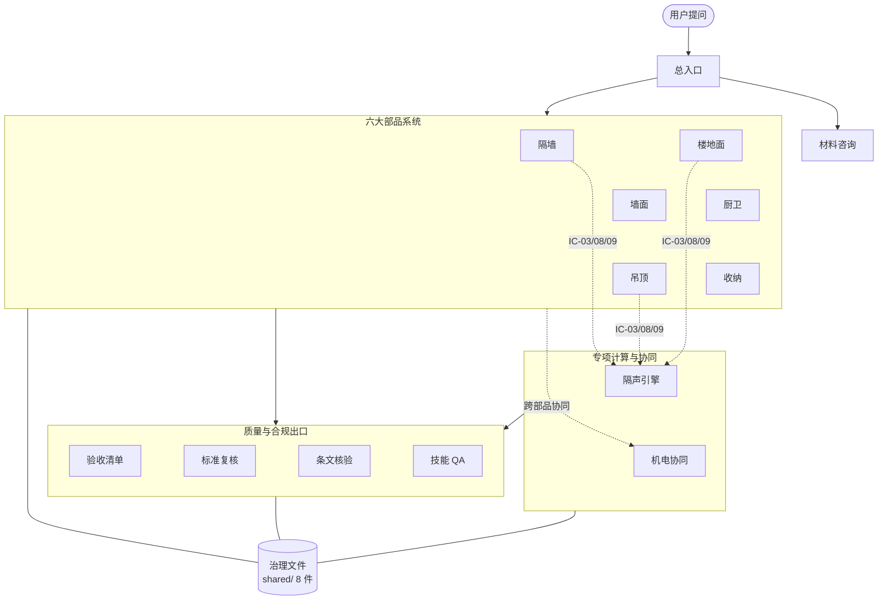
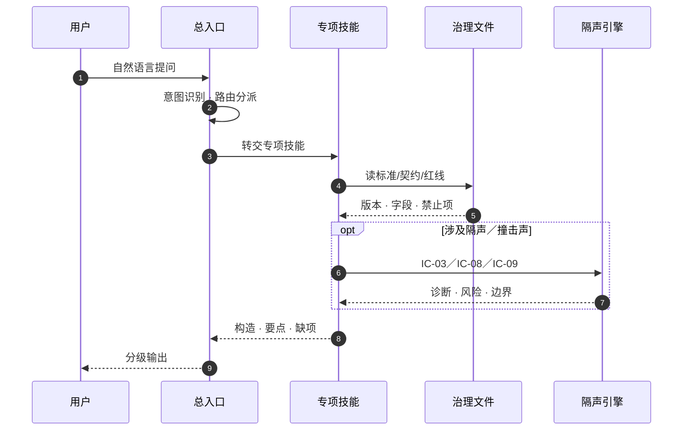
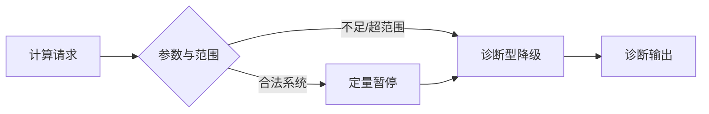
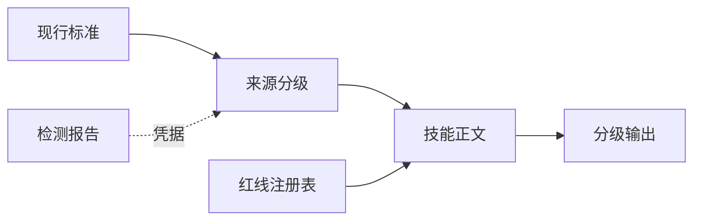

<div align="center">
  
  <h1>装配式装修智能体技能合集</h1>
  <p>15 个可加载的智能体技能：隔墙 · 墙面 · 吊顶 · 楼地面 · 厨卫 · 收纳，配套声学计算 · 机电协同 · 验收 · 规范复核</p>
  <p>
    
    
    
    
    <a href="https://github.com/eiway112/prefab-interior-agent/actions/workflows/smoke.yml"></a>
  </p>
</div>

> **一句话**：把装配式装修的选型、构造、机电协同、验收与规范复核，做成智能体能直接调用的技能；每条数值尽量带**来源分级**与**核验状态**，越界时明确说「这条不成立」。

> **它和「直接问大模型」的区别**：不是更能说，而是**说得出依据，也说得出边界**。已核验条文与未核验条文分开标；已废止的标准会标出来，并给出替代版本；缺依据时降级或拒答，而不是编一个看起来专业的数。

> **先看边界**：本仓是**技能安装包**，不是开发源码仓。技能本体、治理文件与安装/自检工具随包；维护脚本、核验报告与执行记录**不随包**，需要跑完整门禁时回开发仓。文件构成与计数见[公开面边界](#公开面边界随包--不随包)；只想看输出长什么样，直接翻[示例输出](#示例输出)。

> **30 秒上手**：`git clone https://github.com/eiway112/prefab-interior-agent.git && cd prefab-interior-agent && python tools/install.py`（Python 3.10+，无第三方依赖）。

## 3 分钟上手

```sh
git clone https://github.com/eiway112/prefab-interior-agent.git
cd prefab-interior-agent
python tools/install.py          # 装到 ~/.qoder/skills，可用 --target 改目录
python tools/smoke_test.py --target ~/.qoder/skills   # 自检 15 技能 + 8 份治理文件
```

重启智能体宿主，直接提问即可。需要 Python 3.10+，无第三方依赖。手动安装与其他平台见[快速开始](#快速开始)。

## 这是什么

技能遵循通用的 `SKILL.md` 约定（YAML frontmatter ＋ Markdown 正文），可在支持该约定的智能体平台中加载复用。合集覆盖**隔墙、墙面、吊顶、楼地面、厨卫、收纳**六大部品系统，配套**隔声计算引擎、机电管线协同、验收清单生成、规范标准复核**等专项能力，并内置 8 份治理文件（标准索引、接口契约、红线注册表、术语表、数据分级与变更治理规则；**文档随包分发，维护脚本与核验报告不随包**）。

装进平台后直接用自然语言提问即可。模块边界、数据流与扩展点见 [ARCHITECTURE.md](ARCHITECTURE.md)。合集以「总入口路由 ＋ 专项技能协同」工作：综合问题由编排技能识别意图并分派，专项问题直达对应技能，跨部品问题走机电集成协调与集成校验。

| 你问 | 合集做什么 |
|---|---|
| “分户隔墙选什么方案能达到 Rw 45 dB？” | 隔墙技能给出候选构造对比（轻钢龙骨双空腔 / ALC 条板等），调用隔声计算引擎给出**诊断、风险识别与适用边界**（系统定量预测现阶段暂停，可引用匹配的检测报告值）；超范围时按红线拒给确定数值 |
| “酒店卫生间用整体卫浴，防水底盘和排水坡度怎么控？” | 厨卫技能给出湿区防水接口、坡度与**两次闭水试验**等工序控制点及验收要点 |
| “厨房地柜、吊柜的深度和台面高度按什么标准？” | 收纳技能按已核验条文给出取值：地柜／水槽柜深度 550～600mm（JG/T 219-2017 5.3.1）、吊柜深度 320／350mm（5.3.2）、台面高 800～850mm（JGJ/T 477-2018 4.3.2）；吊柜深 300mm 与高柜高 2400mm 明确标注为行业做法、非标准系列值 |
| “地暖＋浮筑地面做完，面层标高会抬高多少？” | 楼地面技能按构造层次**逐层实算**标高增量，并提示不同口径不得混用 |
| “这个隔墙方案里的数值有依据吗？” | 标准复核技能对指标表逐项核规范版本、条文定位与数据档位（S1 国标条文 / S2 检测统计 / S3 经验常数 / S4 行业估算） |
| “帮我把这套方案的过程验收清单拉出来” | 验收清单技能按空间 × 部品系统 × 施工阶段生成可检查、可记录、可整改闭环的清单 |
| “管线在吊顶和隔墙空腔里怎么走才不冲突？” | 机电集成技能做跨部品管线协调、检修口布置与安装顺序编排 |

> 输出分级是设计出来的：**风险审查优先 / 仅供方案比较**等档位显式标注，并附关键假设与适用边界；隔声系统定量预测（含 dB 与数字区间）现阶段暂停，待独立验证后恢复，确定性性能数据以 CMA/CNAS 检测报告和现行标准为准。

## 目录

- [3 分钟上手](#3-分钟上手)
- [这是什么](#这是什么)
- [示例输出](#示例输出)
- [能力地图](#能力地图)
- [一次提问怎么走](#一次提问怎么走)
- [技能矩阵（15 个）](#技能矩阵15-个)
- [隔声计算引擎（ACE）](#隔声计算引擎ace)
- [治理与证据体系](#治理与证据体系)
- [公开面边界（随包 / 不随包）](#公开面边界随包--不随包)
- [代码架构](ARCHITECTURE.md)
- [质量与测试](#质量与测试)
- [快速开始](#快速开始)
- [目录结构](#目录结构)
- [行尾前提（最容易踩的一条）](#行尾前提最容易踩的一条)
- [运行环境](#运行环境)
- [版本与迭代策略](#版本与迭代策略)
- [引用与署名](#引用与署名)
- [边界与免责声明](#边界与免责声明)

## 示例输出

不想先装？[`examples/`](examples/) 放了四份**技能真实应答样例**，由开发仓从各技能自己的 `examples.md` 原样抽取，不改写、不补数值：

| 示例 | 技能 | 演示什么 |
|---|---|---|
| [隔墙方案验证](examples/01-partition-wall-verification.md) | 隔墙 | 11 维逐项验证，隔声维度标 🔲 与「不可引用」，给出核实路径 |
| [厨卫选型对比](examples/02-bathroom-kitchen-selection.md) | 厨卫 | 三条技术路线对比，防水与排水给到条文级依据与来源档位 |
| [机电红线拦截](examples/03-mep-redline-check.md) | 机电集成 | 触碰红线时直接拒给做法，并给合规替代与依据 |
| [标准边界核验](examples/04-standards-review.md) | 标准复核 | 逐条核「≥」与「＞」是否与标准原文表述一致 |

样例里的项目与参数都是示例设定，不是项目交付文件；正式结论以匹配可溯源的检测报告与现行标准为准。读法与分级说明见 [`examples/README.md`](examples/README.md)。

## 能力地图



> 图中只放短标签，完整目录名以[技能矩阵](#技能矩阵15-个)为单源：OR＝`prefab-interior-systems-orchestrator`、EXP＝`prefab-interior-materials-expert`、PW／WS／CL／FL／BK／ST＝`prefab-partition-wall-solution`／`prefab-wall-surface-system`／`prefab-ceiling-system`／`prefab-floor-system`／`prefab-bathroom-kitchen-system`／`prefab-storage-system`、ACE＝`acoustic-calculation-engine`、MEP＝`prefab-mep-integration-system`、AC／SR／SV／QT＝`prefab-acceptance-checklist-generator`／`prefab-standards-reviewer`／`scanned-standard-clause-verify`／`skill-qa-tester`；圆柱 GOV＝`shared/` 下 8 件治理文件（逐件职责见[治理与证据体系](#治理与证据体系)）。用户能力图不含维护向的 `prefab-governance-sync`，它只用于治理文件同步，见技能矩阵。

三层协作：**部品技能**给方案与构造，**专项引擎**给诊断、风险识别与适用边界（系统定量预测现阶段暂停），**质量合规技能**在出口把关（指标复核、红线拦截、验收闭环）；全部技能共同消费同一套治理文件，保证口径单源。技能间接口按编号契约（IC-xx）注册，请求/响应字段有单一事实源。

## 一次提问怎么走



## 技能矩阵（15 个）

| 域 | 技能 | 解决什么 |
|---|---|---|
| 协调 | `prefab-interior-systems-orchestrator` | 合集总入口：意图识别、路由分派、跨专业冲突协调 |
| 协调 | `prefab-interior-materials-expert` | 材料选型、规范解读、质量问题诊断与综合咨询 |
| 部品 | `prefab-partition-wall-solution` | 分户墙/室内隔墙选型：双空腔轻钢龙骨、双排龙骨、ALC 条板等路线的隔声/耐火/成本对比与施工控制 |
| 部品 | `prefab-wall-surface-system` | 墙面系统：无龙骨点式调平、龙骨调平（GL/UL/LGS）、干法直挂与饰面板工艺 |
| 部品 | `prefab-ceiling-system` | 集成/干法/模块化吊顶：隔声贡献估算、管线协同、检修口与标高控制 |
| 部品 | `prefab-floor-system` | 浮筑/架空/干法调平/快装地面：撞击声改善评估、标高推算、管线分离 |
| 部品 | `prefab-bathroom-kitchen-system` | 整体卫浴与集成厨房：防水底盘、湿区接口、排水坡度、闭水试验、洁具安装 |
| 部品 | `prefab-storage-system` | 模块化收纳：玄关柜/衣柜/橱柜/卫浴柜的尺寸模数、墙地顶接口与安装顺序；厨房橱柜尺寸可追溯至 JG/T 219-2017、JGJ/T 477-2018、GB/T 18884.4-2015 条文级来源，超系列值显式披露 |
| 专项 | `acoustic-calculation-engine` | 通用隔声计算引擎（M1—M7 物理模型，见下节） |
| 专项 | `prefab-mep-integration-system` | 机电管线集成：管线分离策略、检修路径、设备点位、安装顺序编排 |
| 质量 | `prefab-acceptance-checklist-generator` | 过程检查/隐蔽验收/分项验收/竣工交付清单生成与整改闭环 |
| 质量 | `prefab-standards-reviewer` | 技术指标表的规范标准核验：版本有效性、条文定位、数据档位 |
| 质量 | `scanned-standard-clause-verify` | 扫描版/文本版标准 PDF 的身份核验与条文原文核验流水线（**公开面只含流程与判据**，预检工具、核验报告与索引/CG 登记不随包） |
| 质量 | `skill-qa-tester` | 技能质量测试：功能完整性、数据准确性、内部一致性、红线合规 |
| 治理 | `prefab-governance-sync` | 治理文件三层同步与发布流程（**公开面只作流程参考**，L1 源与同步器不随包） |

> `waterproofing-expert`（建筑防水工程技术顾问）已于 2026-08-14 迁出本合集，独立维护于建筑专业辅材技能合集项目；本合集各技能保留对其的跨合集外部协同引用。

## 隔声计算引擎（ACE）

隔声是本合集估算密度最高的专业面，单独抽成通用引擎，由隔墙/楼地面/吊顶技能经编号接口（IC-03 空气声 / IC-08 撞击声 / IC-09 侧向传声）调用。



**当前输出规则**（PL-229 暂停期）：

| 输入情况 | 引擎返回 | 不返回 |
|---|---|---|
| 合法系统 | 诊断型降级：质量与频率诊断、声桥/缝隙风险、关键假设、适用边界、人工评估建议 | dB、数字区间、精度承诺 |
| 参数不足 / 超范围 | 降级结构：缺失项、风险识别、超出范围提示 | 猜填参数、确定数值 |
| 有匹配且可溯源的检测报告 | 可引用报告原评价量，并记录报告编号与匹配核对 | 以同材料或相似构造推定同构造；以 STC 当 Rw；把报告值外推为变体性能 |
| 需要工程结论 | 以 CMA/CNAS 检测报告和现行标准为准 | 以模型预测替代检测或验收 |

| 层 | 内容 |
|---|---|
| 物理模型 M1—M7 | 质量定律 · Cremer 吻合效应 · 双叶墙 MSM 共振 · 空腔增益 · 撞击声改善量 · 声桥/缝隙修正 · 检测报告基准校准 |
| 可执行内核 | `acoustic-calculation-engine/ace_kernel.py`（Python 3.8+，仅标准库；唯一入口 `compute_request(ic_id, request)`，参数不足/超范围一律以降级结构返回而非抛错） |
| 输出纪律 | 现阶段对合法系统定量预测一律返回**诊断型降级**（不含 dB 与数字区间）；可引用匹配的检测报告值；**超出模型适用范围时拒给确定数值**（红线） |
| 数据纪律 | 材料参数与基准表带来源分级（S1 国标条文 / S2 产品检测统计 / S3 经验常数 / S4 行业估算）；S2 及以下输出附数据源说明 |

## 治理与证据体系

本合集不只是一组提示词——每个技能背后是同一套可核查的治理文件（随仓分发，位于 `skills/shared/`、`skills/standards-index.md` 与 `skills/platform-adapter-reference.md`）：

| 文件 | 承担什么 |
|---|---|
| `standards-index.md` | 规范标准索引：收录标准的编号、名称、效力状态（现行/废止/被替代）与**核验状态标注**；条数以该件头部计数现读为准（公开面不含 §八变更日志） |
| `shared/redlines-registry.md` | 红线注册表：逐技能登记“不得违反”的输出约束（如超范围禁给确定数值、评价量不得混用），条数以该件现读为准 |
| `shared/interface-contracts.md` | 技能间接口契约（IC-xx 编号化）：请求/响应字段约束的单一事实源 |
| `shared/standards-reasoning-rules.md` | 标准适用性推理规则：废止标准降级、替代切换、地域适用性等判则 |
| `shared/data-classification.md` | 数据分类与取证判据：四类量（限值/派生量/物理参数/叙述）的来源与分级要求 |
| `shared/glossary.md` | 跨技能共用术语表（触发词与专业名词的统一口径） |
| `shared/change-governance.md` | 变更治理规则：S/A/B/C 定级、审批流程与变更日志（**公开面不含 §九／§11.2**） |
| `shared/platform-adapter-reference.md` | 平台适配参考：跨智能体平台加载的适配说明 |



> **来源分级**：S1 国标条文 / S2 检测统计 / S3 经验常数 / S4 行业估算。检测报告与核验成果**不随包**，正文中的相关路径只作来源指认。

配套机制（写进技能正文、可被提问直接触发）：**已废止标准自动降级并提示替代关系**；**实验室评价量（Rw+C）与现场评价量（DnT,w+C）不得混用**；**估算与检测值不得互替**；数值缺依据时显式降级而不是编造。

## 公开面边界（随包 / 不随包）

本仓是**技能分发面**：只含技能本体与治理文件镜像。开发仓的过程记录、维护脚本与校验门禁（治理登记、批凭据、各道验证脚本）不随本仓分发。

| 类别 | 随包（合计 95 个文件） | 不随包 |
|---|---|---|
| 技能本体 | 15 个技能目录，65 个文件（含 4 个 Python 件：`ace_kernel.py`、`sre_reasoner.py`、2 件测试） | — |
| 治理文件 | `shared/` 8 件 ＋ 根级副本 2 件（`standards-index.md`、`platform-adapter-reference.md`），共 10 个文件 | 开发仓 `治理文件/` L1 源、`台账源/`、数据分类复核清单；`change-governance.md` 的 §九／§11.2；`standards-index.md` 的 §八 |
| 根级文件 | `README.md`、`ARCHITECTURE.md`、`LICENSE`、`CHANGELOG.md`、`.gitattributes`、`assets/logo.png`、`CONTRIBUTING.md`、`SECURITY.md`、`CODE_OF_CONDUCT.md`，共 9 个文件 | — |
| 工程工具 | `tools/`（安装器、自检、说明）3 件；`.github/`（CI、两类 issue 模板）3 件，共 6 个文件 | 开发仓的维护脚本、批凭据脚本、发布门禁 |
| 示例输出 | `examples/`（索引页 1 件 ＋ 示例 4 件），共 5 个文件 | — |
| 证据与记录 | — | `核验成果/`、`执行记录/`、`文档目录/`（含检测报告、核验报告、产品资料原件） |

**计数**：65 ＋ 10 ＋ 9 ＋ 6 ＋ 5 ＝ 95 个文件；上表按文件归属划分，不重复计数。

**为什么这样切**：证据与记录可能含本机环境、项目信息与开发过程；维护脚本依赖开发仓的目录结构；台账是内部追溯面。正文中出现的这些路径只作**来源指认**，在本仓不可直接打开。

**派生纪律**：本仓由开发仓的派生器生成；内容改动先落开发仓，再重新派生，不直接编辑本仓。

## 质量与测试

本仓自带 **104 例**可跑的回归测试，全部随包；安装后即可复跑：

| 套件 | 例数 | 运行方式（安装后） |
|---|---|---|
| SRE 引擎回归 | 84 | `python <安装目录>/prefab-standards-reviewer/sre_regression_test.py` |
| IC-07 合规回归 | 20 | `python <安装目录>/prefab-standards-reviewer/sr_ic07_compliance_test.py` |

CI 在 Ubuntu／Windows × Python 3.10／3.12 上执行：包结构自检、安装到临时目录并复检、上述 104 例。

开发仓另有 22 道门禁（台账一致性、数据分类、冻结基准、跨层字节一致等）不随包。**公开面通过只证结构一致与随包测试通过，不证内容正确**；数值与条文的正确性以核验记录与检测报告为准。

## 快速开始


**方式 A：一条命令（推荐）**

```sh
git clone https://github.com/eiway112/prefab-interior-agent.git
cd prefab-interior-agent
python tools/install.py          # 可用 --target 指定其他技能目录、--dry-run 只看计划
python tools/smoke_test.py --target ~/.qoder/skills
```

**方式 B：手动复制**

1. 下载本仓库：在仓库页面点击 **Code → Download ZIP**，或执行
   - GitHub：`git clone https://github.com/eiway112/prefab-interior-agent.git`
   - Gitee：`git clone https://gitee.com/eiway112/prefab-interior-agent.git`
2. 将 `skills/` 下所需的技能目录复制到你所用平台的**技能加载目录**（例如 Qoder：`~/.qoder/skills/`；Windows 下为 `C:\Users\<你的用户名>\.qoder\skills\`。其他平台请以其文档为准）。
3. **必装项**：请将全部技能目录连同 `skills/standards-index.md` 与 `skills/shared/` 一并复制。技能正文硬引用 `../shared/`（红线注册表、接口契约、术语表等治理约束），缺 `shared/` 时技能仍会加载但**静默失去红线与契约约束、不报错**——只复制单个技能目录拿到的是弱化版。复制这些件不会补回开发仓的维护脚本、核验报告与执行记录。
4. 重启你的智能体平台，直接提问即可，例如：“分户隔墙选什么方案能达到 Rw 45 dB？”

**装完自检**：`python tools/smoke_test.py --target <安装目录>` 应输出 PASS（15 个技能、8 份治理文件、标准索引）。缺任一件即停止，不要以「能加载」当作「完整可用」。

## 目录结构

```
prefab-interior-agent/
├── README.md / LICENSE / CHANGELOG.md / CONTRIBUTING.md
├── SECURITY.md / CODE_OF_CONDUCT.md
├── tools/                               ← install.py（安装）· smoke_test.py（自检）
├── .github/                             ← CI（push / PR 跑自检）· issue 模板
├── assets/                              ← 品牌资源
├── examples/                            ← 示例输出：四份真实应答样例 ＋ 索引
└── skills/                              ← 对外引用入口：技能本体与治理文件
    ├── prefab-*/ · acoustic-*/ · scanned-*/ · skill-qa-tester/
    │                                    ← 15 个技能目录（SKILL.md ＋ reference/examples 等）
    ├── standards-index.md               ← 规范标准索引（含核验状态标注）
    ├── platform-adapter-reference.md    ← 平台适配参考
    └── shared/                          ← 治理文件 8 件（契约·红线·术语·数据分级·变更治理等）
```

> 随包 / 不随包的完整清单见[公开面边界](#公开面边界随包--不随包)。

## 行尾前提（最容易踩的一条）

仓根 `.gitattributes` 声明 `* text eol=lf`，请保留。你的机器若设了 `core.autocrlf=true`（Windows 上常见，且可能是全局而非仓库级），删掉或绕过该文件会让清洁克隆的工作树整体转成 CRLF，从而与文件内部记录的字节形态不一致。自验法：`git ls-files --eol` 中文本件应落 `i/lf`。

## 运行环境

技能为纯文本资产，直接复制即可用，无运行依赖。ACE 可执行内核 `ace_kernel.py` 仅用 Python 3.8+ 标准库。开发仓的维护脚本另需 Python 3.10+（部分脚本有 PEP 604 签名），这些脚本不随包。

## 版本与迭代策略

- 本仓按语义化版本打标签发布（当前 `v1.2.0`）；引用请锁定到 tag 或具体 commit（`git describe --tags` 可读最近标签），避免跟随 main 拿到中间状态。公开面变更见 [CHANGELOG.md](CHANGELOG.md)。
- 公开面变更见 [CHANGELOG.md](CHANGELOG.md)；各技能的具体版本以 `SKILL.md` frontmatter 的 `version` 字段为准。
- 规范标准修订、技能内容勘误以 PATCH/MINOR 发布；架构或契约级调整以 MAJOR 发布。
- 反馈与纠错：欢迎开 Issue（使用问题、数据纠错、标准失效线索均可），维护者对数据纠错类 Issue 承诺 **3 个工作日内**响应；安全类问题请走 [SECURITY.md](SECURITY.md) 的私密通道；协作方式见 [CODE_OF_CONDUCT.md](CODE_OF_CONDUCT.md)。后续演进方向为单技能独立版本发布与 Releases 分发打包产物。

## 引用与署名

本仓库采用 [MIT License](LICENSE)。复制、引用或二次开发请保留版权声明；建议引用格式：

> 装配式装修智能体技能合集 vX.Y.Z，艾为智造（长沙）科技有限公司，https://github.com/eiway112/prefab-interior-agent

## 边界与免责声明

- 技能输出为工程技术参考意见，不替代注册执业人员的正式设计文件。
- 隔声、耐火等确定性性能数据须以 CMA/CNAS 检测报告和现行国家/行业标准为准；技能内置估算模型仅用于方案比较。
- 项目落地前请结合工程所在地法规、设计文件与产品实际参数核实。
